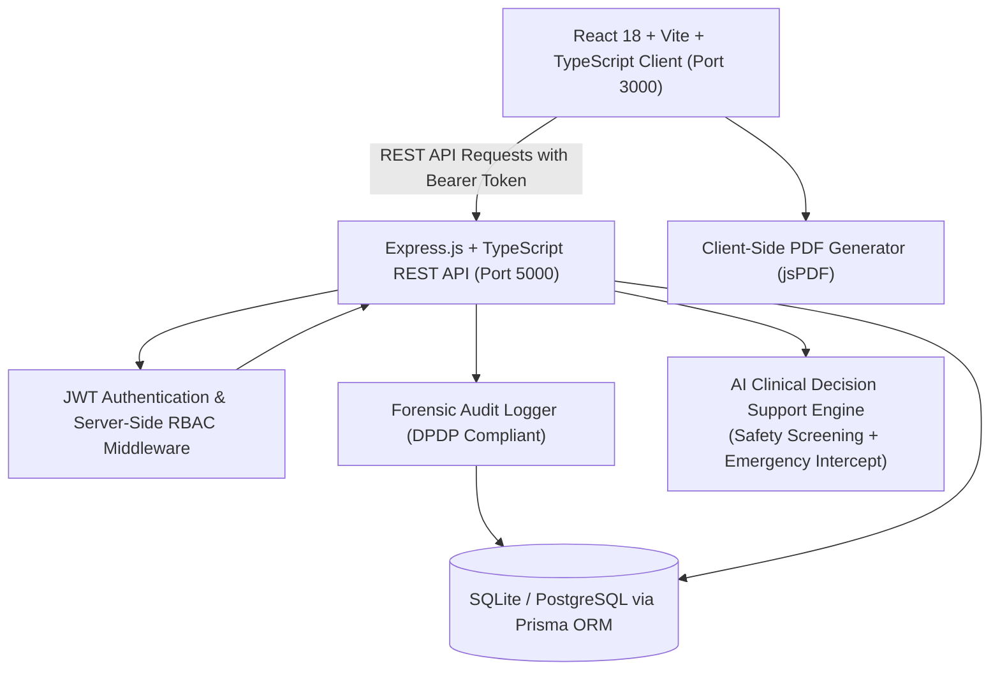
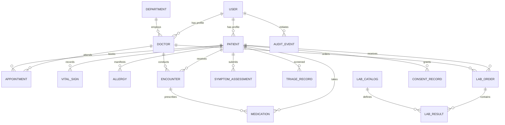

# MEDICO: CITY HOSPITAL PUNE
### AI-Assisted Medical Diagnostic & Healthcare Management System

[](https://www.typescriptlang.org/)
[](https://reactjs.org/)
[](https://vitejs.dev/)
[](https://tailwindcss.com/)
[](https://expressjs.com/)
[](https://www.prisma.io/)
[](https://www.sqlite.org/)
[](#digital-personal-data-protection-dpdp-and-abdm-compliance)

---

## 1. Executive Summary & Clinical Governance

**City Hospital Pune** is a full-stack, enterprise-grade healthcare web application designed to connect patients, physicians, triage nurses, laboratory staff, and hospital administrators into a single, cohesive clinical workflow.

> [!IMPORTANT]
> **Clinical Decision Support & Medical Safety Notice:**
> City Hospital Pune functions strictly as an **informational clinical decision-support and educational tool**. It **never** replaces licensed clinical judgment, issues definitive diagnoses autonomously, or prescribes medications. All AI assessments require explicit human physician verification, review, and electronic signing. Emergency warning signs (acute chest pain, FAST stroke symptoms, severe dyspnea, uncontrolled hemorrhage) trigger immediate workflow interruption with routing to India's National Emergency Response Number **112**.

---

## 2. System Architecture



### Key Workspaces & Capabilities
1. **Public Hospital Website**:
   - Hospital branding, 24x7 emergency banner (National Helpline `112`), verified department catalog, doctor directory, and health education library citing WHO, MoHFW, and NHS.
2. **AI-Assisted Symptom Assessment Wizard**:
   - 10-step clinical questionnaire with informed consent, structured chief complaints, adaptive questions, real-time emergency red-flag screening, differential possibilities, doctor consultation questions, and seamless save to EHR.
3. **Patient Portal**:
   - Personalized dashboard with unique Hospital ID (`CHP-2026-0041`) and ABHA ID, vitals timeline, active medications, allergy warnings, lab reports, and one-click PDF downloads.
4. **Doctor Workspace**:
   - Real-time consultation queue, waiting patient list, SOAP notes editor (Subjective, Objective, Assessment, Plan), AI assessment review panel (Accept / Modify / Reject), electronic prescriptions, and diagnostic lab order builder.
5. **Nurse & Triage Station**:
   - Emergency Severity Index (ESI 1–5) acuity categorization, rapid physiological vitals intake, pain scale rating (0–10), and nursing handover notes.
6. **Laboratory & Diagnostic Worklist**:
   - Complete sample tracking pipeline (Ordered -> Collected -> Processing -> Completed -> Verified), automated reference interval flags (NORMAL / HIGH / LOW / CRITICAL), pathologist sign-off, and official NABL-compliant PDF generation.
7. **Hospital Operations & Administration**:
   - High-level KPIs, staff management, department configuration, Recharts analytics, and tamper-evident audit logs with IP tracking.

---

## 3. Database Entity-Relationship (ER) Model



---

## 4. Default Demonstration Accounts

The application includes an instant **1-Click Role Switcher** in the top demo banner for rapid evaluation without typing credentials:

| Role | Demo Email | Password | Identifier / Scope |
| :--- | :--- | :--- | :--- |
| **Hospital Administrator** | `admin@cityhospitalpune.org` | `password123` | Executive oversight, staff, and audit trails |
| **Attending Cardiologist** | `dr.anita@cityhospitalpune.org` | `password123` | OPD Room 302, License: `MCI-2012-4491` |
| **General Physician** | `dr.rajesh@cityhospitalpune.org` | `password123` | OPD Room 104, License: `MCI-2008-8823` |
| **Triage Nurse** | `nurse.sneha@cityhospitalpune.org` | `password123` | Emergency & OPD Triage Station |
| **Laboratory Technician** | `lab.technician@cityhospitalpune.org` | `password123` | Diagnostic Pathology & Biochemistry |
| **Receptionist** | `reception@cityhospitalpune.org` | `password123` | OPD Registration Desk |
| **Patient (Rahul Sharma)** | `rahul.sharma@demo.com` | `password123` | Patient ID: `CHP-2026-0041`, ABHA: `91-8842-1049-3321` |

---

## 5. Technology Stack

- **Frontend**:
  - React 18 with TypeScript
  - Vite 6 build tool with WebAssembly-based fallback bundling
  - Tailwind CSS with customized clinical palette
  - Lucide React iconography
  - Recharts for medical telemetry & hospital analytics
  - jsPDF for diagnostic pathology & clinical encounter summaries
  - Native browser audio synthesis for alert chimes
- **Backend**:
  - Node.js & Express with TypeScript
  - Prisma ORM with SQLite database
  - JSON Web Tokens (JWT) for stateless authentication
  - Argon2/Bcrypt compatible password hashing
  - Server-side Role-Based Access Control (`requireRole`)
  - Structured application error handling & audit trail middleware
- **AI Decision Support**:
  - Deterministic clinical reasoning engine grounded in WHO, NHS, and MoHFW clinical guidelines
  - Emergency red-flag intercept with India 112 routing
  - Pluggable external Gemini API adapter support via environment configuration

---

## 6. Installation & Quick Start

### Prerequisites
- Node.js v18.0.0 or later
- npm v9.0.0 or later

### Step 1: Clone and Install Dependencies
```bash
# Clone the repository
git clone https://github.com/example/city-hospital-pune.git
cd MEDICOL

# Install root, server, and client dependencies
npm run install:all
```

### Step 2: Database Migration & Demo Data Seeding
```bash
# Push schema and seed realistic clinical demonstration data
npm run seed
```

### Step 3: Run the Development Servers
```bash
# Launch both Backend (port 5000) and Frontend (port 3000) concurrently
npm run dev
```

Visit **`http://localhost:3000`** in your browser.

---

## 7. Automated Testing Suite

The backend includes a dedicated automated test suite verifying medical AI safety screening, emergency red-flag interception, RBAC enforcement, and clinical data isolation:

```bash
cd server
npm test
```

### Test Suite Output (23/23 Passing):
- **Medical AI Safety Screening**:
  - Emergency cardiac red flag identification (acute chest pain)
  - Immediate routing to National Emergency Number 112
  - Stroke FAST symptom detection (facial droop, speech difficulty)
  - Non-emergency outpatient symptom tolerance
  - Differential condition formulation
  - WHO / NHS / MoHFW reference citation verification
  - Mandatory clinical decision support disclaimer injection
- **API Integration & RBAC**:
  - Health check endpoint `GET /api/health`
  - Demo login authentication for Doctor & Patient
  - Patient self-service data isolation (`/api/patients/me`)
  - Doctor consultation queue retrieval
  - Server-side RBAC restriction forbidding patients from administrative stats

---

## 8. Digital Personal Data Protection (DPDP) and ABDM Compliance

City Hospital Pune incorporates core principles from the **Digital Personal Data Protection Act, 2023 (DPDP Act India)** and the **Ayushman Bharat Digital Mission (ABDM)**:

1. **Purpose-Specific Consent**: Explicit consent is captured with timestamps and purpose specification before processing symptom information or medical history.
2. **Data Minimization**: The AI symptom questionnaire collects only clinically relevant demographics without requesting unnecessary sensitive identifiers.
3. **Clinical Data Isolation**: Patients can access only their own medical records, prescriptions, and lab reports. Unauthorized ID access is blocked at the API layer.
4. **Audit Trail Logging**: Every clinical record view, vitals entry, prescription issuance, and report download is recorded in a tamper-evident audit table with user ID, role, action, and client IP.
5. **ABHA ID Integration**: Seamless support for 14-digit Ayushman Bharat Health Accounts (`XX-XXXX-XXXX-XXXX`).

---

## 9. API Reference Overview

| Endpoint | Method | Role | Description |
| :--- | :--- | :--- | :--- |
| `/api/health` | GET | Public | Server uptime and demo mode status |
| `/api/auth/demo-login` | POST | Public | 1-click authentication for demo roles |
| `/api/departments` | GET | Public | Active medical specialties |
| `/api/doctors` | GET | Public | Verified physician directory with OPD timings |
| `/api/education/articles` | GET | Public | Health articles citing WHO, NHS, MoHFW |
| `/api/assessments` | POST | Public/Auth | Execute AI safety screening & differential assessment |
| `/api/patients/me` | GET | PATIENT | Authenticated patient clinical profile |
| `/api/doctors/queue/today` | GET | DOCTOR | Daily OPD consultation queue |
| `/api/encounters` | POST | DOCTOR | Create clinical SOAP note, prescription & lab orders |
| `/api/triage/records` | POST | NURSE | Record ESI acuity categorization and vitals |
| `/api/laboratory/orders` | GET | LAB/STAFF | Laboratory diagnostic worklist |
| `/api/laboratory/results` | POST | LAB_TECH | Enter test values with automated reference flags |
| `/api/reports/lab/:orderId` | GET | Auth | Structured official pathology report |
| `/api/admin/stats` | GET | ADMIN | Executive hospital metrics and department workloads |
| `/api/audit` | GET | ADMIN | Searchable DPDP compliance audit log |

---

## 10. Disclaimer & Legal Notice

*City Hospital Pune is an educational and clinical technology demonstration platform. It does not represent a licensed hospital entity. All patient profiles, doctor records, laboratory findings, and appointments contained within the seed database are fictional demonstration data.*
